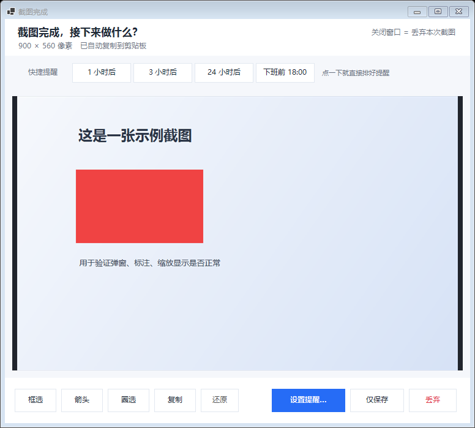
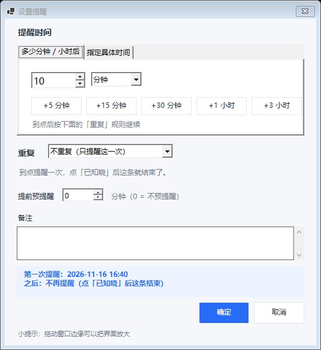
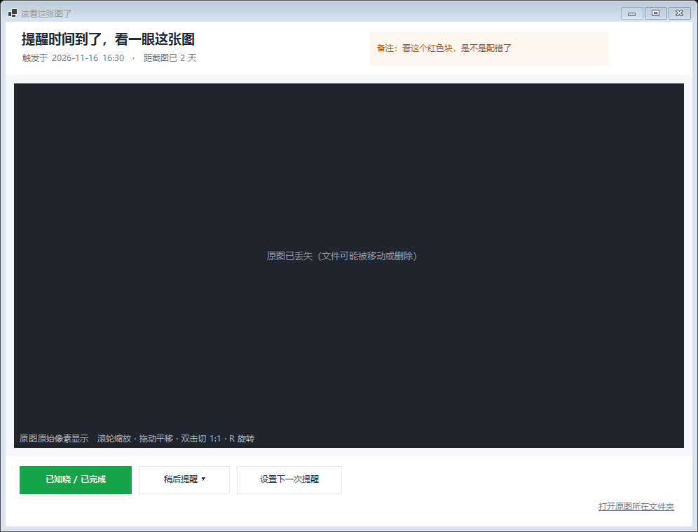
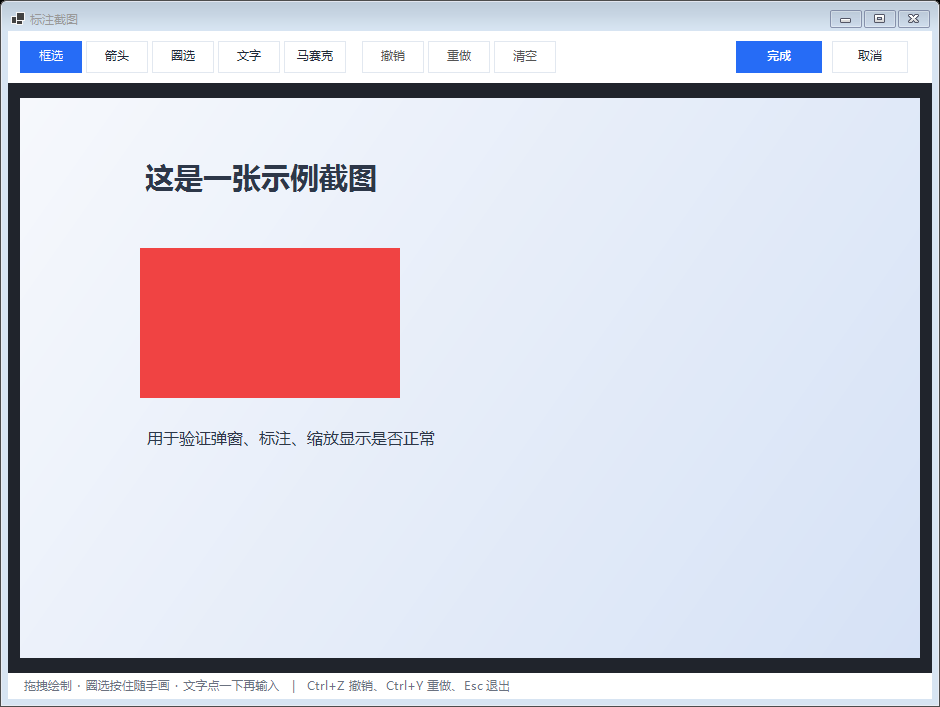
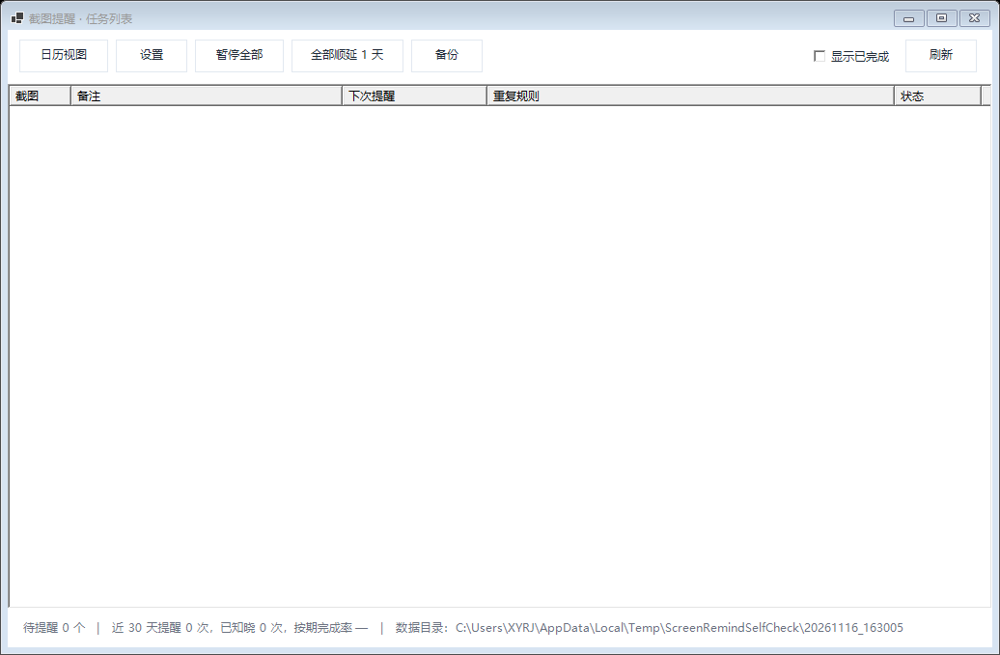
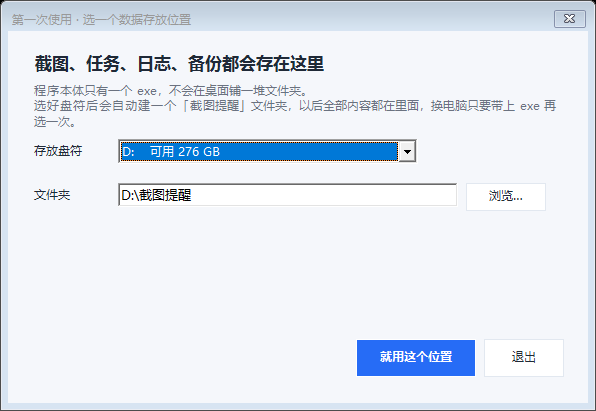

# CapAlert · 截图提醒

> 按一下快捷键框选屏幕，到点把**原图**弹到你面前；看完点「已知晓」，顺手定下一次。

一个 Windows 桌面小工具：**截图 → 设提醒 → 到点看原图**。全程离线，不联网、不写注册表、
不用装运行库——一个 exe 拷到任何 Win10/11 机器上双击就能用。

*English: a tiny offline Windows utility. Capture a screen region, schedule a reminder, and the
original (uncompressed) image pops back at you at the time you set. Portable single-file EXE,
no installer, no network, no telemetry. The UI is in Chinese.*

**作者 / Author：** Vear-ximao　·　**联系邮箱：** 1289453937@qq.com　·　**许可：** [MIT](LICENSE)

---

## 它解决什么问题

客户改稿意见、报错截图、配色参考、别人的排班表……这些图截下来存进文件夹，然后就再也没打开过。
这个工具的想法很简单：**让截图自己找上门**。

按 `Ctrl+Alt+S` 框一块屏幕 → 选「2 小时后」或「每周一三五」→ 到点弹窗，原图按原始像素显示，
可以放大到 800% 看细节。看完点「已知晓」结束，或者顺手定下一次。

---

## 功能

### 截图
- 全局快捷键触发，**任意组合**都能录：`Ctrl+Alt+S`、`Ctrl+Alt`、`A+S`、`Ctrl+Shift+F1`（最多 4 键）
- 框选时铺一层冻结画面，所见即所裁；回车=整屏，`W`=当前窗口，Esc=取消
- 多显示器、高分屏（Per-Monitor V2）按**物理像素**裁切，不糊不偏
- 截图前自动最小化自身窗口，不会截到自己，也不影响「W 截当前窗口」判定

### 提醒
- 相对时间（N 分钟/小时后）与绝对时间（年月日时分）
- 六种重复：不重复 / 每隔 N 分·时·天 / 每天 / 每周（多选星期）/ 每月（自动处理 31 号与小月）/ 指定月份
- 结束条件：永不 / 截止某日 / 共 N 次（选了重复才出现）
- 底部预览用大白话写清「第一次几点、之后怎么重复、下一次几点」
- 睡眠唤醒后补弹一次，不会连环炸屏；支持免打扰时段（跨零点）

### 看图与处理
- 原图 **PNG 无损**保存，永不重编码；缩放只发生在显示层
- 滚轮跟光标缩放 10%–800%、拖动平移、双击切 1:1、`R` 旋转
- 三个出口：已知晓 / 稍后提醒 / 设置下一次（同图延续，不复制文件）

### 标注
- 框选、箭头、**手绘圈选**、文字、马赛克
- `Ctrl+Z` 撤销、`Ctrl+Y` 重做、`Ctrl+Delete` 清空，全部按钮按状态置灰
- 标注烧进成品图，原图另存 `*.orig.png`；标糊了点「还原」退回未标注原图

### 数据与便携
- 首次启动选一个盘，此后数据全在 `<盘>:\截图提醒`，**桌面不会堆一堆文件夹**
- 程序本体只有一个 exe，旁边只有几十字节的位置标记
- 单实例、托盘常驻、开机自启（启动文件夹快捷方式，不写注册表）
- 一键备份/还原（zip）、主界面密码（PBKDF2，只锁界面不加密文件）

---

## 界面

| 截图处理面板 | 设置提醒 |
|---|---|
|  |  |

| 到点提醒 | 标注 |
|---|---|
|  |  |

| 任务列表 | 首次启动选数据位置 |
|---|---|
|  |  |

---

## 快速开始（普通用户）

> **系统要求**：Windows 10 1607 及以上 / Windows 11，**64 位**。不需要安装 .NET 或任何运行库（exe 已自包含）。

1. 到 [Releases](../../releases) 下载 `CapAlert-v1.3.2-win-x64.zip`
2. 解压到任意位置（桌面、D 盘、U 盘都行），双击 `截图提醒.exe`
3. 首次启动会问数据存哪块盘 → 选盘 → 自动建 `D:\截图提醒`
4. 按 `Ctrl+Alt+S` 开始截图；图标常驻右下角托盘

> 不需要安装 .NET 或任何运行库，exe 已自包含。杀软可能对单文件自解压报警（Python/C# 单文件打包的通病），
> 加信任即可。

---

## 从源码构建

需要 **Windows + .NET 8 SDK**（[下载](https://dotnet.microsoft.com/download/dotnet/8.0)）。

```bash
git clone https://github.com/Vear-ximao/CapAlert.git
cd CapAlert

# 编译（调试）
dotnet build src/ScreenRemind/ScreenRemind.csproj -c Release

# 发布单文件便携版（产物在 out/）
dotnet publish src/ScreenRemind/ScreenRemind.csproj -c Release -o out
```

发布参数已在 csproj 里配好：`win-x64` / 自包含 / 单文件 / 压缩，产物约 66 MB。

---

## 操作速查

| 场景 | 操作 |
|---|---|
| 截图 | `Ctrl+Alt+S`（可改）→ 拖框 → 松手 |
| 截整屏 / 当前窗口 | 框选界面按 `回车` / `W` |
| 快速排提醒 | 处理面板顶部：1 小时 / 3 小时 / 24 小时 / 下班前 |
| 标注快捷键 | `Ctrl+Z` 撤销、`Ctrl+Y` 重做、`Ctrl+Delete` 清空 |
| 看图 | 滚轮缩放、拖动平移、双击 1:1、`R` 旋转、`←/→` 换图 |
| 关闭提醒弹窗 | = 稍后 N 分钟（默认 15，可在设置改，防止误关丢提醒） |
| 关掉处理面板 | = 丢弃本次截图（有标注时二次确认，可选只存图） |

---

## 项目结构

```
src/ScreenRemind/
├─ Core/          纯逻辑：路径、存储、重复规则引擎、调度、备份、密码（不碰 UI，不碰 P/Invoke）
├─ Platform/      唯一允许 P/Invoke 的一层：抓屏、全局热键、单实例、自启
├─ UI/            WinForms 窗体与自绘控件
├─ AppController  装配与流程编排（截图→建任务→到点弹窗→出口处理）
├─ Diagnostics    无界面自检：--check / --render-test / --check-ui
└─ Program.cs     入口
tests/SelfTest/   白盒断言（把 Core 源码编进独立工程直接测）
tools/IconCraft/  图标流水线：PNG → 多尺寸 ICO，含从 exe 反向提取
docs/             使用说明、快速上手、版本变更
```

分层纪律：**UI 不碰文件、Core 不碰控件、P/Invoke 只出现在 Platform/NativeMethods.cs**。

> 命名说明：产品名是 **CapAlert / 截图提醒**，但代码内部的工程名与命名空间保留了历史命名 `ScreenRemind`
> （目录 `src/ScreenRemind/`、`RootNamespace=ScreenRemind`）。改它要动 csproj、命名空间和 CI 路径，
> 收益不大，故保持稳定；你只需认准产品名。

---

## 自检与测试

```bash
# 逻辑自检：重复规则边界（月末/闰年/跨年）、数据损坏恢复、路径、热键组合、免打扰、密码、备份
dotnet run --project tests/SelfTest/SelfTest.csproj

# 运行期诊断：不弹界面，真实抓一次屏、验证 PNG 回读、探测热键是否可用
截图提醒.exe --check          # 报告写到 <数据目录>\logs\selfcheck_*.txt

# 界面渲染自检：把每个窗体渲染成 PNG，用来查布局崩没崩
截图提醒.exe --render-test
```

自检覆盖的边界包括：每月 31 号在小月自动落到 30/28 号、闰年 2 月 29、跨年回绕、
`tasks.json` 损坏自动用 `.bak` 恢复、免打扰跨零点与锚点不漂移、左右 Ctrl 键归一化、
备份还原（路径越界拒绝与失败回滚）、出口状态流转与「下一次」严格晚于当前。

---

## 数据与隐私

- **完全离线**：不联网、不上传、无账号、无云同步、无遥测
- **数据在你选的盘**：`<盘>:\截图提醒\{data,shots,logs,backups}`，删掉文件夹即彻底卸载
- **密码只锁界面**：`shots/` 里是明文 PNG，拿到文件夹就能看（README 不夸大安全能力）
- 不写注册表、不写 AppData；唯一的例外是开机自启会在用户启动目录放一个快捷方式

---

## 已知限制

1. 单文件首次启动要解压到临时目录，**冷启动 1–2 秒**；体积约 66 MB（.NET 自包含）
2. `Ctrl+Alt` 这类纯修饰键组合、或 `A+S` 这种多字母组合，需要键盘钩子，
   个别游戏反作弊/安全软件可能拦截，且无法事前检测占用（设置里会明确提示）
3. 提醒精度 ±1 秒量级；**睡眠期间不触发**，唤醒后补弹一次（设计如此）
4. 撤销只在当前这次标注内有效；跨会话请用「还原」
5. 多显示器混合 DPI 场景仅在一台 1920×1080 单屏机器上验证过
6. 界面为中文，未做多语言

---

## 参与贡献

见 [CONTRIBUTING.md](CONTRIBUTING.md)。提 Issue 请带上：
系统版本、复现步骤、`<数据目录>\logs\` 里对应的日志、以及 `--check` 生成的诊断报告。

## 许可证

[MIT](LICENSE) © 2026 Vear-ximao
